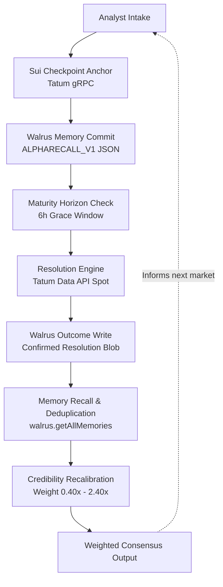

# AlphaRecall

Decentralized prediction engine and forecaster credibility matrix that learns over time.

`Track 1: Markets & Sports Prediction` · `Tatum x Walrus Hackathon (Total Recall)`

---

## Live Links & Resources

| Resource | Link | Notes |
|---|---|---|
| Live Web Application | [https://alpharecall.vercel.app](https://alpharecall.vercel.app) | Production deployment on Vercel |
| Source Code Repository | [https://github.com/0x-zeze/Alpharecall](https://github.com/0x-zeze/Alpharecall) | Branch `main` & `bento-redesign` |
| Demo Video | `TODO: Add 2-3 minute walkthrough video` | Record UI walkthrough and resolution pass |
| Technical Blog Post | `TODO: Add blog post URL after publication` | Overview of memory-driven consensus |
| Walruscan Mainnet Explorer | [https://walruscan.com/mainnet](https://walruscan.com/mainnet) | Verify onchain blobs |

---

## What It Does

Traditional prediction markets and sports tipping platforms suffer from amnesia because predictions and past track records are siloed in ephemeral databases that can be silently edited or reset. AlphaRecall solves this by persisting every prediction and resolution immutably to Walrus Memory on Sui mainnet. At maturity, forecasts are verified against authentic market rates, generating an explicit accuracy delta. A deterministic mathematical scoring engine computes dynamic credibility weights (0.40x to 2.40x) from historical resolution memories. Future market consensus scales by these weights, naturally boosting verified sharps while dampening reckless forecasters.

---

## How It Works



1. **Intake & Anchoring:** The system accepts an analyst forecast and queries the latest Sui checkpoint via the Tatum gRPC gateway to anchor creation time.
2. **Memory Commitment:** The forecast is encoded into a structured `ALPHARECALL_V1` JSON payload and committed to Walrus Mainnet storage via `@mysten-incubation/memwal`.
3. **Maturity Check:** When a forecast reaches its deadline, the automated resolver evaluates it within a 6-hour grace window.
4. **Rate Resolution:** The resolver queries the Tatum Data API for the live market exchange rate to determine if target conditions were met.
5. **Outcome Write:** The verified result (`ACCURATE` or `FAILED`) is committed as a resolution memory blob to Walrus.
6. **Memory Recall & Deduplication:** The client recalls past resolution blobs using `getAllMemories()` and deduplicates records per prediction ID.
7. **Credibility Recalibration:** Forecaster scores map through a bounded linear formula to calculate an active weight multiplier between 0.40x and 2.40x.
8. **Consensus Recalibration:** Aggregate market sentiment multiplies each analyst's opinion by their credibility weight, replacing unweighted headcounts.

---

## What Is Live vs Backtest

| Dataset Type | Scope & Origin | Verification Status | Role in AlphaRecall |
|---|---|---|---|
| **Historical Backtest Seeds** | 16 records from real October 2024 fixtures (El Clasico, Premier League, NBA, Sui spot breakout). Fictional analyst handles (`@OptaTactics`, `@MacroCryptoQuant`, etc.). | Written to Walrus Mainnet. Carries authentic `blobId` receipts on Walruscan. | Establishes the initial credibility variance and demonstrates how memory shifts consensus. |
| **Live User Forecasts** | New predictions submitted during the hackathon via the slide-over form. | Stored with status `PENDING` and delta `0`. Crypto forecasts require future deadline $\le 30$ days. | Demonstrates end-to-end forward resolution and onchain memory creation in real time. |

> **Note on Simulated Stakes and P&L:** All stake amounts (default $250) and resulting profit/loss figures are purely simulated tracking metrics for bankroll analysis and paper performance. They do not represent real fiat or cryptocurrency deposits.

---

## Walrus and Tatum Usage

| Integration | Role in Architecture | Implementation File |
|---|---|---|
| **Tatum Sui gRPC Gateway** | Primary source for Sui checkpoint sequence and digest over HTTP/2 TLS (`sui-mainnet-grpc.gateway.tatum.io:443`). | `lib/sui-grpc.ts` |
| **Tatum Sui JSON-RPC Gateway** | Secondary fallback attempt (`sui-mainnet.gateway.tatum.io`), currently returns 404 on Sui JSON-RPC. | `lib/tatum.ts` |
| **Tatum Data API v3** | Live crypto exchange rate queries (`/v3/tatum/rate/{symbol}?basePair=USD`) for resolving target prices at deadline. | `lib/tatum.ts`, `lib/resolver.ts` |
| **Tatum Gateway Version API** | Gateway metadata monitoring (tier, usage, latency, version). | `lib/tatum.ts`, `app/api/tatum/route.ts` |
| **ESPN Public Scoreboard (Unofficial)** *(Non-Tatum)* | Unofficial endpoint for upcoming match fixtures, final scores, and team logos (`site.api.espn.com`). Team logos belong to their respective copyright holders and are loaded directly from the ESPN CDN (`a.espncdn.com`). Crypto coin icons are vendored locally under CC0-1.0 (`public/coins/README.md`). | `lib/espn.ts`, `lib/fixtures.ts`, `lib/sports-resolver.ts` |
| **Sui Mainnet GraphQL** *(Non-Tatum)* | Tertiary fallback for Sui checkpoint telemetry (`https://graphql.mainnet.sui.io/graphql`) when Tatum gateways are unreachable. | `lib/tatum.ts` |
| **Walrus Memory SDK** *(Non-Tatum)* | Client-side memory SDK (`@mysten-incubation/memwal`) used to store, update, and recall immutable prediction records. | `lib/walrus.ts` |
| **Walrus Hosted Relayer** *(Non-Tatum)* | Ephemeral write relayer (`https://relayer.memory.walrus.xyz`) processing onchain blob storage on Sui mainnet. | `lib/walrus.ts` |

---

## Verified Walrus Mainnet Blobs

The 16 historical seed records in AlphaRecall are committed to Walrus Mainnet storage nodes. Every record is verifiable via the public explorer:

| # | Prediction ID | Match / Market Event | Walrus Mainnet Blob ID | Explorer Link |
|---|---|---|---|---|
| 1 | `rec-01` | El Clasico: Real Madrid 0 - 4 FC Barcelona | [`MDppsKhZlP...D6OkJPZo`](https://walruscan.com/mainnet/blob/MDppsKhZlP6LG3FgAOKkiwd-Zs00vZxCNSBD6OkJPZo) | [Walruscan](https://walruscan.com/mainnet/blob/MDppsKhZlP6LG3FgAOKkiwd-Zs00vZxCNSBD6OkJPZo) |
| 2 | `rec-02` | Premier League: Arsenal 2 - 2 Liverpool Over 2.5 Goals | [`Pvl2qLR-Mt...UsixPaVE`](https://walruscan.com/mainnet/blob/Pvl2qLR-MtlscsT6Xefn1hMa6pKDxgAHUEdUsixPaVE) | [Walruscan](https://walruscan.com/mainnet/blob/Pvl2qLR-MtlscsT6Xefn1hMa6pKDxgAHUEdUsixPaVE) |
| 3 | `rec-03` | UEFA Champions League: Real Madrid 5 - 2 Borussia Dortmund | [`MlY3RrUcDu...rQSPbU8k`](https://walruscan.com/mainnet/blob/MlY3RrUcDu9yZqt4azuEqjNU_CAAdkQ1J6-rQSPbU8k) | [Walruscan](https://walruscan.com/mainnet/blob/MlY3RrUcDu9yZqt4azuEqjNU_CAAdkQ1J6-rQSPbU8k) |
| 4 | `rec-04` | UEFA Champions League: FC Barcelona 4 - 1 Bayern Munich | [`IId5yX8mny...J1-F1WO0`](https://walruscan.com/mainnet/blob/IId5yX8mnya--n6K7fsU_eULIa3GBhJUzSgJ1-F1WO0) | [Walruscan](https://walruscan.com/mainnet/blob/IId5yX8mnya--n6K7fsU_eULIa3GBhJUzSgJ1-F1WO0) |
| 5 | `rec-05` | NBA: Boston Celtics 119 - 108 Milwaukee Bucks (-9.5) | [`EGTVpuhtIy...k2-EBXPo`](https://walruscan.com/mainnet/blob/EGTVpuhtIybSbbkAH4YW07k2EC7V0BAxnvxk2-EBXPo) | [Walruscan](https://walruscan.com/mainnet/blob/EGTVpuhtIybSbbkAH4YW07k2EC7V0BAxnvxk2-EBXPo) |
| 6 | `rec-06` | NBA: Nikola Jokic Over 26.5 Points (Nuggets vs Raptors) | [`_qRNwZHJxn...0_asDHNM`](https://walruscan.com/mainnet/blob/_qRNwZHJxnGQGFIYTqNWJB6fmzUAqJTAhjv0_asDHNM) | [Walruscan](https://walruscan.com/mainnet/blob/_qRNwZHJxnGQGFIYTqNWJB6fmzUAqJTAhjv0_asDHNM) |
| 7 | `rec-07` | Premier League: West Ham 2 - 1 Manchester United | [`BY17qQqMED...TyQ1V0CI`](https://walruscan.com/mainnet/blob/BY17qQqMED4GWhhO8bOIs9qN_NErjaRIL5xTyQ1V0CI) | [Walruscan](https://walruscan.com/mainnet/blob/BY17qQqMED4GWhhO8bOIs9qN_NErjaRIL5xTyQ1V0CI) |
| 8 | `rec-08` | Sui Ecosystem: SUI Spot Resistance Breakout > $2.00 | [`vLRIaRkHJB...8ANBGXRY`](https://walruscan.com/mainnet/blob/vLRIaRkHJBz6mAcv0FB5gwdtYxa-n59y4Lk8ANBGXRY) | [Walruscan](https://walruscan.com/mainnet/blob/vLRIaRkHJBz6mAcv0FB5gwdtYxa-n59y4Lk8ANBGXRY) |
| 9 | `rec-09` | Bitcoin Macro: BTC Spot Liquidity Sweep to $69,450 | [`9pWbhl1oxT...Jc8bYY0M`](https://walruscan.com/mainnet/blob/9pWbhl1oxTgTqOiZnA-cQGcc-jXI9T1tId-Jc8bYY0M) | [Walruscan](https://walruscan.com/mainnet/blob/9pWbhl1oxTgTqOiZnA-cQGcc-jXI9T1tId-Jc8bYY0M) |
| 10 | `rec-10` | NBA: Los Angeles Lakers 131 - 127 Sacramento Kings | [`325ARz4CvV...j19WCsCU`](https://walruscan.com/mainnet/blob/325ARz4CvVbreH7ARCsuZly3RU5ze2638iDj19WCsCU) | [Walruscan](https://walruscan.com/mainnet/blob/325ARz4CvVbreH7ARCsuZly3RU5ze2638iDj19WCsCU) |
| 11 | `rec-11` | Ethereum Macro: ETH/BTC Ratio Breakdown Under 0.038 | [`jDG2GmeXgQ..._pDDzCAk`](https://walruscan.com/mainnet/blob/jDG2GmeXgQ5pk_eTfDKTWLwBqEGHbf8y2Fq_pDDzCAk) | [Walruscan](https://walruscan.com/mainnet/blob/jDG2GmeXgQ5pk_eTfDKTWLwBqEGHbf8y2Fq_pDDzCAk) |
| 12 | `rec-12` | Premier League: Chelsea 2 - 1 Newcastle United | [`_cR7biDzHi...6lioLGVw`](https://walruscan.com/mainnet/blob/_cR7biDzHiTXYmAytnbnVMFmH5DZ64GTnbs6lioLGVw) | [Walruscan](https://walruscan.com/mainnet/blob/_cR7biDzHiTXYmAytnbnVMFmH5DZ64GTnbs6lioLGVw) |
| 13 | `rec-13` | UEFA Champions League: Real Madrid vs AC Milan | [`TDVgtJ4dxh...wELA8v3Y`](https://walruscan.com/mainnet/blob/TDVgtJ4dxhJhJOb6p2o18tt0vkH4zGzELh4wELA8v3Y) | [Walruscan](https://walruscan.com/mainnet/blob/TDVgtJ4dxhJhJOb6p2o18tt0vkH4zGzELh4wELA8v3Y) |
| 14 | `rec-14` | UEFA Champions League: Inter Milan vs Arsenal | [`0LM0vnhkdq...a6AfCBPE`](https://walruscan.com/mainnet/blob/0LM0vnhkdqCqQDYSHVzbqeH94VvDy3f1C40a6AfCBPE) | [Walruscan](https://walruscan.com/mainnet/blob/0LM0vnhkdqCqQDYSHVzbqeH94VvDy3f1C40a6AfCBPE) |
| 15 | `rec-15` | NBA: Boston Celtics vs Golden State Warriors Over 228.5 | [`7oV_zeh_81...7kZPkCcA`](https://walruscan.com/mainnet/blob/7oV_zeh_81qAaAJ1n7kuNES1w2nQDBnSxBh7kZPkCcA) | [Walruscan](https://walruscan.com/mainnet/blob/7oV_zeh_81qAaAJ1n7kuNES1w2nQDBnSxBh7kZPkCcA) |
| 16 | `rec-16` | Sui Ecosystem: SUI Spot Re-accumulation Test > $1.85 | [`ZFuFsoI9iH...3dE50sSA`](https://walruscan.com/mainnet/blob/ZFuFsoI9iHgQGvn_gwkZag7XhGYmMxPN5kG3dE50sSA) | [Walruscan](https://walruscan.com/mainnet/blob/ZFuFsoI9iHgQGvn_gwkZag7XhGYmMxPN5kG3dE50sSA) |

*Manifest stored in source control at `seed-receipts.json`.*

---

## Judging Criteria Mapping

| Hackathon Criterion | Project Evidence & File Reference | Current Operational Status |
|---|---|---|
| **Walrus Integration (30%)** | `lib/walrus.ts`, `lib/memory-codec.ts`, `seed-receipts.json` | 16 verified mainnet blobs active. Codec implements `ALPHARECALL_V1` with full backward compatibility. |
| **Tatum Integration (30%)** | `lib/sui-grpc.ts`, `lib/tatum.ts`, `lib/resolver.ts` | Official Tatum gRPC client implemented with TLS and metadata authentication. Real-time price oracle settlement powered by Tatum Data API v3. Multi-tier fallback falls back through multiple sources and records which one answered with honest attribution. |
| **Technical Quality & Rigor (30%)** | `scripts/run-tests.mjs`, `lib/dedupe.ts`, `lib/credibility.ts` | 60 comprehensive offline unit tests passing. Strict read-after-write verification, zero credential leakage, and typed Next.js App Router endpoints. |
| **Creativity & Presentation (20%)** | `components/dashboard/`, `components/journal/`, Bento Grid UI | Modern data-first dashboard with reactive consensus pivot calculation and live telemetry feeds. |

---

## Architecture & Security

1. **Client Outcome Isolation:** `POST /api/memories` strictly rejects client-supplied `outcome`, `credibilityDelta`, and `pnl` values. All user submissions are initialized to `PENDING` with delta `0`. Outcome mutations can only originate from the server-side settlement pipeline.
2. **Idempotent Settlement:** `POST /api/resolve` fetches existing memories before committing new blobs. If a prediction is already resolved, it is safely skipped (`status: "skipped"`), preventing duplicate writes or doubled credibility deltas.
3. **Synchronous Client Lock & Idempotency Keys:** Form submission locks via `useRef` to eliminate accidental double-tap submits on mobile devices, paired with an in-memory 10-minute cache on `clientRequestId`.
4. **Duplicate Content Gate:** Submissions with identical analyst, target, pick, and deadline within 60 seconds return HTTP 409 Conflict.
5. **Fail-Closed Cron Protection:** `GET /api/resolve` requires an `Authorization: Bearer <CRON_SECRET>` header. Without this secret in production, requests are rejected with HTTP 401.
6. **Admin Gated Seeding:** `POST /api/seed` requires an `x-admin-secret: <ADMIN_SECRET>` header to prevent unauthorized batch storage operations.
7. **Rate Limiting:** In-memory sliding buckets enforce a 30 predictions/hour per-IP limit and a 200 predictions/day global cap.

---

## Known Limitations

* **Forecaster Identity (Text Handles):** Analyst handles (e.g. `@OptaTactics`) are currently user-specified text strings without cryptographic wallet signatures per post. Production implementations will require Sui wallet signatures.
* **Sports Match Settlement:** Automated settlement is fully implemented for crypto markets via Tatum Data API. Sports auto-resolve is available via unofficial ESPN scoreboards behind the `ENABLE_SPORTS_AUTORESOLVE=true` flag. Matches with extra time or penalties (AET/PEN) require manual verification, and total markets strictly require half-numbers (x.5) to prevent ambiguous push outcomes. The ESPN scoreboard API is unofficial and operates without an SLA.
* **Serverless In-Memory State:** Rate limit counters and deduplication caches reside in Node.js runtime memory. In distributed serverless multi-region deployments, an external store like Redis is recommended for distributed consistency.
* **Spot Grace Window vs Historical Tick:** Settlement uses spot rates queried during a 6-hour grace window (`RESOLVER_GRACE_WINDOW_MS = 6h`) following deadline rather than tick-level historical prices. Predictions evaluated after the grace window expire unresolved.
* **Permanent Early Test Blobs:** Submissions executed during early test phases before the 60-second duplicate gate resulted in permanent `@AlphaOne` duplicate blobs on Walrus. These are deduplicated at read time via `dedupePredictions()` without data corruption.

---

## Getting Started

### Prerequisites
* Node.js **>= 22.0.0**
* npm **>= 10.0.0**

### 1. Clone Repository
```bash
git clone https://github.com/0x-zeze/Alpharecall.git
cd Alpharecall
```

### 2. Install Dependencies
```bash
npm install
```

### 3. Configure Environment Variables
Copy `.env.example` to `.env.local`:
```bash
cp .env.example .env.local
```

| Variable | Description | Required | Example |
|---|---|---|---|
| `TATUM_API_KEY` | Tatum API Key from https://dashboard.tatum.io | Yes | `t-64...` |
| `MEMWAL_PRIVATE_KEY` | Ed25519 delegate private key for Walrus Memory | Yes | 64-char hex string |
| `MEMWAL_ACCOUNT_ID` | Walrus Memory account object ID | Yes | `0x...` |
| `MEMWAL_SERVER_URL` | Walrus Relayer endpoint | Optional | `https://relayer.memory.walrus.xyz` |
| `MEMWAL_NAMESPACE` | Memory namespace isolation | Optional | `alpharecall` |
| `CRON_SECRET` | Secret bearer token for automated resolver cron | Yes (Prod) | `your_cron_secret` |
| `ADMIN_SECRET` | Secret header for `/api/seed` endpoint | Yes (Prod) | `your_admin_secret` |
| `ALLOW_PUBLIC_ORACLE_FALLBACK` | Allow CoinGecko fallback when Tatum is down | Optional | `false` |
| `NEXT_PUBLIC_ENABLE_SEED` | Show UI button for seed trigger in Sidebar | Optional | `false` |
| `ENABLE_SPORTS_AUTORESOLVE` | Enable ESPN match auto-resolve for sports | Optional | `false` |

### 4. Generate Delegate Key (Helper)
Generate a fresh Ed25519 keypair for Walrus Memory delegation:
```bash
npm run keygen
```

### 5. Run Offline Test Suite
Run the 60 unit tests locally with mock servers (zero network footprint):
```bash
npm test
```

### 6. Run Development Server
```bash
npm run dev
```
Open [http://localhost:3000](http://localhost:3000).

---

## Vercel Deployment Guide

1. Push your code to GitHub and import the repository into Vercel.
2. In Vercel Project Settings, configure the environment variables listed in the table above.
3. Build Settings:
   * Framework Preset: **Next.js**
   * Build Command: `npm run build`
   * Node.js Version: **22.x**

---

## Automated Resolution (GitHub Actions Scheduler)

Automated settlement runs every 30 minutes via GitHub Actions: [`.github/workflows/resolve-scheduler.yml`](.github/workflows/resolve-scheduler.yml).

### Required GitHub Secrets
Under **Settings** -> **Secrets and variables** -> **Actions**:
* `APP_URL`: Production URL starting strictly with `https://` (e.g. `https://alpharecall.vercel.app`). Non-HTTPS URLs fail closed.
* `CRON_SECRET`: Secret token matching the `CRON_SECRET` configured in Vercel.

---

## Project Structure

```text
alpharecall/
├── app/                      # Next.js App Router pages and API routes
│   ├── api/memories/         # Forecast creation and Walrus memory retrieval
│   ├── api/resolve/          # Automated settlement engine (cron protected)
│   ├── api/seed/             # Baseline seed script endpoint (admin protected)
│   ├── api/tatum/            # Live telemetry for Tatum Gateway & Sui Checkpoints
│   ├── layout.tsx            # Global layout shell and meta configuration
│   └── page.tsx              # Main dashboard view orchestrator
├── components/               # React UI presentation components
│   ├── credibility/          # Credibility matrix and consensus breakdown
│   ├── dashboard/            # Bento grid metric cards and bankroll charts
│   ├── journal/              # Prediction journal table and submission slide-over
│   └── layout/               # Navigation sidebar, mobile drawer, and header
├── lib/                      # Core business logic and integrations
│   ├── credibility.ts        # Credibility scoring and consensus pivot formulas
│   ├── dashboard-stats.ts    # Pure metrics calculations and record classifiers
│   ├── dedupe.ts             # Prediction deduplication and merge functions
│   ├── memory-codec.ts       # ALPHARECALL_V1 payload encoding and decoding
│   ├── resolver.ts           # Deadline evaluation and price comparison engine
│   ├── sui-grpc.ts           # Native Tatum Sui gRPC client implementation
│   ├── tatum.ts              # Tatum Data API and Sui checkpoint source chain
│   ├── types.ts              # Canonical TypeScript interface declarations
│   └── walrus.ts             # Mysten Labs MemWal SDK connector
├── proto/                    # Vendored Sui RPC v2 Protocol Buffers
│   ├── ledger-service-descriptor.json # In-memory descriptor for serverless
│   ├── README.md             # Proto source documentation and commit tracking
│   └── sui/rpc/v2/           # Mysten Labs Sui RPC v2 proto definitions
├── scripts/                  # Automation and testing utilities
│   ├── run-tests.mjs         # Comprehensive offline test suite (60 tests)
│   ├── seed-mainnet.mjs      # Walrus mainnet baseline seeding script
│   └── ts-loader.mjs         # Native TypeScript loader for Node.js
└── seed-receipts.json        # Canonical 16 onchain Walrus blob receipts
```

---

## License

MIT License. See [LICENSE](LICENSE) for details.
